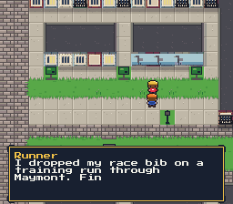
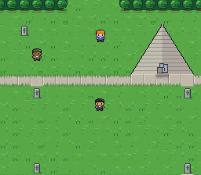

# River City Quest for the Super Nintendo

[](https://github.com/doodersrage/river-city-quest-snes/actions/workflows/build.yml)

A port of [River City Quest](https://github.com/doodersrage/river-city-quest), the Zelda-style adventure set in Richmond, Virginia, to a real SNES ROM.

**Download:** the newest build is always on the [latest release](https://github.com/doodersrage/river-city-quest-snes/releases/tag/latest) as `RiverCityQuest.sfc`.
Open it in any SNES emulator (Snes9x, bsnes, Mesen, RetroArch; Snes9x EX+ on Android), or copy it to a flash cart to play on real hardware.

| | |
|---|---|
|  |  |
| Reading the Arthur Ashe marker in the Fan | Talking to the Runner |
|  |  |
| The Fan, where you start | Walk south into Hollywood Cemetery |

## What works so far

- **Stage 1:** walk all 24 outdoor neighbourhoods, from Richmond Raceway to Ancarrow's Landing, using the web game's art. Walk off any edge into the next neighbourhood. Start is in the Fan.
- **Stage 2:** press A to read historical markers, landmarks, signs, murals and gas lamps, and to talk to the 70 people standing around town, in the web game's own pixel font. People turn to face you and cycle through their lines.

Every build is played in the snes9x core in CI: it reads a marker, talks to someone and walks into the next neighbourhood (`tools/boottest.py`, driven by `tools/sneslab.py`).
Branch builds are published as `dev-<branch>` pre-releases for testing.

See [ROADMAP.md](ROADMAP.md) for the stages still to come.

## Building

Needs a built [PVSnesLib](https://github.com/alekmaul/pvsneslib) (CI pins the exact commit in `.github/workflows/build.yml`).

```sh
export PVSNESLIB_HOME=/path/to/pvsneslib
make
```

### Regenerating the art from the web game

The converted data in `data/` is committed, so building does not need this. To refresh it after the web game changes:

```sh
git clone https://github.com/doodersrage/river-city-quest ../river-city-quest
tools/regen.sh ../river-city-quest
```
