# River City Quest for the Super Nintendo

[](https://github.com/doodersrage/river-city-quest-snes/actions/workflows/build.yml)

A port of [River City Quest](https://github.com/doodersrage/river-city-quest), the Zelda-style adventure set in Richmond, Virginia, to a real SNES ROM.

**Download:** the newest build is always on the [latest release](https://github.com/doodersrage/river-city-quest-snes/releases/tag/latest) as `RiverCityQuest.sfc`.
Open it in any SNES emulator (Snes9x, bsnes, Mesen, RetroArch; Snes9x EX+ on Android), or copy it to a flash cart to play on real hardware.

| | |
|---|---|
| 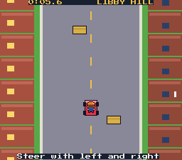 | 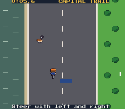 |
| 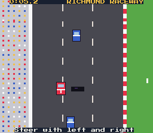 | 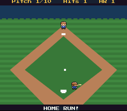 |
| 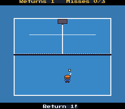 | 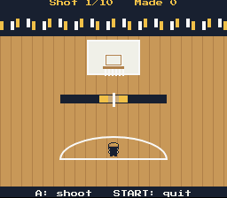 |
| 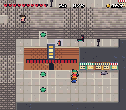 | 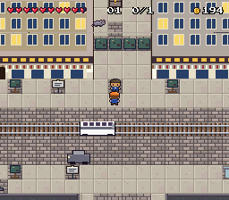 |
| 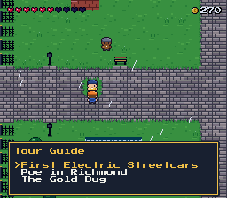 | 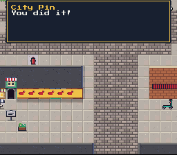 |
| 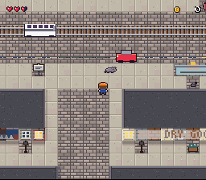 | 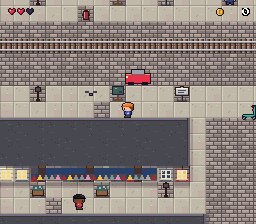 |
| 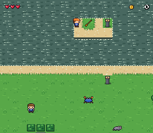 | 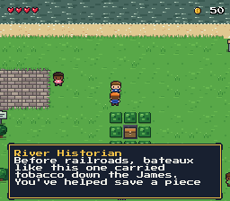 |
| 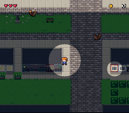 | 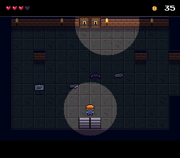 |
| 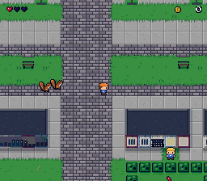 | 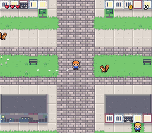 |
| 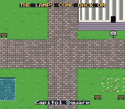 | 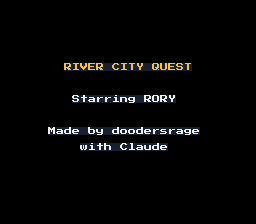 |
| 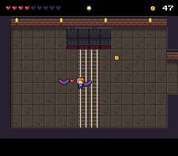 | 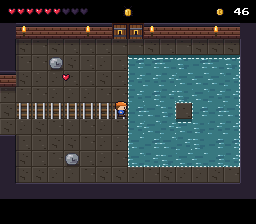 |
| 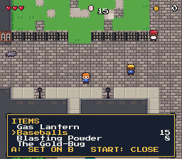 | 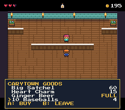 |
| 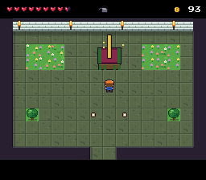 | 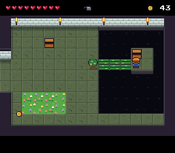 |
| 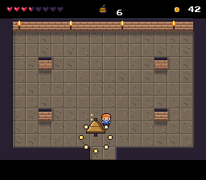 | 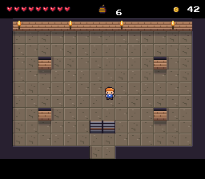 |
| 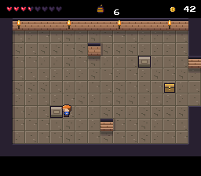 | 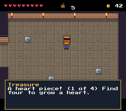 |
| 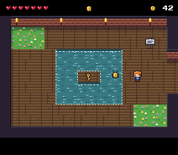 | 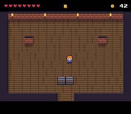 |
| The Gold-Bug fetching the key from the island | The Raven beaten: the Brick Keystone |
| 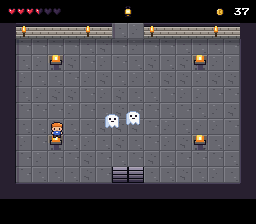 | 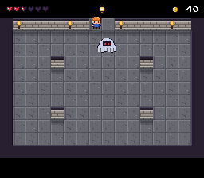 |
| Every brazier lit in the Hall of Lamps | The Wraith, solid after its own orb hits it |
|  | 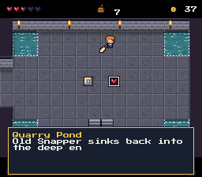 |
| Old Snapper wakes in the Quarry Pond | Beaten: the Granite Keystone and a heart container |
|  |  |
| The Iron Foreman in Tredegar's Furnace Hall | Beaten: stairs and a heart container |
| 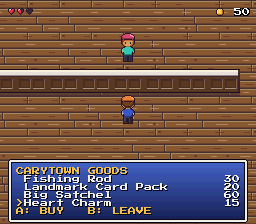 | 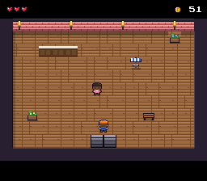 |
| Buying a heart charm at Carytown Goods | Your row house in the Fan |
| 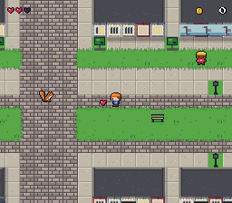 |  |
| The paddle against a squirrel in the Fan | Hold A, let go: spin attack |
| 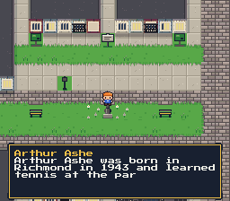 |  |
| Reading the Arthur Ashe marker in the Fan | Talking to the Runner |
|  |  |
| The Fan, where you start | Walk south into Hollywood Cemetery |

## What works so far

- **Stage 1:** walk all 24 outdoor neighbourhoods, from Richmond Raceway to Ancarrow's Landing, using the web game's art. Walk off any edge into the next neighbourhood. Start is in the Fan.
- **Stage 2:** press A to read historical markers, landmarks, signs, murals and gas lamps, and to talk to the 70 people standing around town, in the web game's own pixel font. People turn to face you and cycle through their lines.

- **Stage 10 (in progress): challenges and minigames.** All 14 neighbourhood challenges: talk to the person with a blinking "!" and race the clock to gather melons, taps, fly balls, lures and river trash, beat the bus or the trolley to a flag, clear out rats, ghosts or crabs, light Church Hill's gas lamps with the lantern, or find Manchester's murals. Each first win is a Richmond city pin and 25 coins; win all 14 and your paddle hits twice as hard. The Tour Guide in Capitol Square quizzes you on stories from your journal (read markers to fill it). Minigames: **batting practice** with the Ballplayer in Scott's Addition once you've won his pin (time your swing; home runs pay best), **Rams free throws** in the Siegel Center (shoot when the needle is in the middle) and **tennis** with the coach on Arthur Ashe Boulevard (run under the ball and swing; three misses and you're done). And three races down a scrolling road, against the clock for a gold, silver or bronze medal: **the Libby Hill soapbox derby** (the Derby Kid on Church Hill: hay bales, cones, puddles), **the Capital Trail time trial** (the Trail Cyclist at Rocketts Landing, once he's given you his old bike: geese, joggers, puddles) and **the Richmond Raceway dash** (the Race Official: slow cars and oil). Pinball, then fishing and landmark cards, come next.
- **Stage 9 (done): town life.** Townspeople stroll around near where they stand, the Pulse bus and cars drive along Broad Street, the Fan, Jackson Ward and five more neighbourhoods (they stop and honk when you step out in front of them, and you can't walk through them), and pigeons sit about town and take off when you come close. **The bateau quest**: the river scattered a bateau's oar, pole and tiller around Pony Pasture and the island off Ancarrow's Landing; bring all three to the river historian there for 50 coins, a heart charm and the Golden Lure (it does its job once fishing arrives in stage 10).
- **Stage 8 (done): day, night, weather and dark rooms.** A ten-minute day: dusk from 5pm, full dark from 8pm, with a circle of light around you (wider with the Gas Lantern) and glows on street lamps, lit windows, wall torches and lit braziers. Dungeons, caves and museums are dark all the time, as in the web game. Rain, fog and snow roll through outdoors, and the night theme plays after dark.
- **Stage 7 (done): music and sound.** The web game's chiptunes, rebuilt as SNESMOD modules straight from its own song data: the town theme, south of the river, the dungeon theme, the forge, the boss theme and the victory theme over the credits, each where the web game plays it. Sixteen sound effects too, from swings and coins to explosions and the item jingle.
- **Stage 6 (done): the whole quest.** With all four keystones, **the Church Hill Tunnel** opens: blast into the Flooded Siding, send the Gold-Bug for the key, light the Signal Room's four lamps, and face **the Richmond Vampire** at Engine 231. It fades in and out around you, throws blood three ways, bursts into a swarm of bats at 60% and rings out blood once it's desperate. Beat it and the fog lifts: the lamps come back on across Church Hill, Capitol Square, Broad Street, the Fan and Carytown, the credits roll, and you're back on Church Hill to keep exploring. Also in this stage: **an item menu on START** (pick what B does; SELECT still cycles) and gear from around town: **Baseballs** from the Ballplayer in Scott's Addition (thrown straight ahead, over water; enemies drop more), **Ginger Beer** from the Brewer in the taproom (drink it for full hearts; he refills it and your hearts), a **Bicycle** from the Trail Cyclist at Rocketts Landing (outdoors only, a third faster, A hops off), and **Running Shoes** from the Runner in the Fan once you find his race bib in Byrd Park (a dash that bowls over small foes; nothing hurts you mid-dash). Carytown Goods now sells baseballs, kegs, Ginger Beer refills and the Big Satchel (carry 50 balls and 16 kegs). Before that, **the Conservatory** at Lewis Ginter Botanical Garden: clear the Orchid Room for the **Watering Can** (B), water sprouts to grow vine bridges across the sunken beds to a key and through Fern Gully, then water **the Titan Arum** under the glass dome so it blooms, and hit it before it closes up again. It spits fans of seeds and sprouts rats. Before that, **the Carillon** in Byrd Park. A trading chain gets you there: a Carytown vendor's melon goes to the Jackson Ward musician for sheet music, which the Byrd Theatre organist swaps for a river map, which a Belle Isle kayaker takes in exchange for a **kayak** (paddle the James to reach Manchester). Blast the rubble in Forest Hill Park for the **Carillon Key**. Inside, shove **push blocks** onto switches to open gates and a key chest, then beat **the Bronze Bell**, which floats out of reach and slams down in a ring of shots; hit it while it rings. It guards the **Bronze Keystone**, the last of four. A cracked wall hides the Belfry Ledge and the first **heart piece** (four make a heart). Before that, the **Poe Museum cellar** under Shockoe Bottom: light the Wine Cellar's braziers for a key, clear the Raven's Study for **the Gold-Bug** (throw it with B: it stuns small foes and fetches what it touches), send it over the Enchanted Garden's pond for the island key, and beat **the Raven** (it hovers, throws feathers and dives) for the **Brick Keystone**. Before that, the Archivist in Capitol Square gives you the **Gas Lantern**. The Hollywood Cemetery **Pyramid** (blast the rubble off its door): light four braziers to open the Hall of Lamps, the **Cast-Iron Shield** (turns shots you face), a key, and **the Wraith**, which you can only hurt after sending its own orb back with the shield or the paddle. It guards the **Iron Keystone**. Earlier in this stage, the Belle Isle Quarry: crabs and bats, a key, the Powder Store and **Blasting Powder** on B (kegs blow open cracked walls and the rubble on the pyramid door, cut bushes and hurt enemies, including you), and **Old Snapper**, who charges in a line and stuns himself on the walls. He guards the **Granite Keystone**, the first of four. SELECT switches between your items. The game now holds a full 60 frames a second everywhere.
- **Stage 5:** Tredegar Iron Works, behind Hollywood Cemetery, start to finish: four rooms, rooms that stay cleared, a chest that appears when you clear the Pattern Shop, the Grappling Hook on B (pull yourself across pits to iron posts, stun enemies), a small key and locked door, a gate that opens when the Casting Floor is cleared, and the Iron Foreman: hook his chest plate off, then paddle him. If the fog takes you in there, you wake at the entrance.
- **Stage 4:** walk through doors into 24 interiors and caves (museums, the Byrd, the Hippodrome, St. John's, the Tea Room, your row house and more), and back out the stairs. Cut bushes. Open the hidden chest in every neighbourhood. Shop at Carytown Goods and the 17th Street Market with your coins. The other dungeons' doors turn you back for now.
- **Stage 3:** A swings the kayak paddle; hold A after a swing and let go for a spin attack. Hearts and coins in the corner. Rats, squirrels, geese, scooters, crabs, bats and ghosts behave as in the web game and drop coins and hearts. When the fog takes you, you wake by the fountain in Capitol Square.

Every build is played in the snes9x core in CI: it reads a marker, talks to someone, beats an enemy, spins, cuts a bush to open a chest, visits the row house, buys a heart charm in Carytown, walks into the next neighbourhood, plays through Tredegar Iron Works, the Belle Isle Quarry, the Pyramid and the Poe cellar, runs the trading quest, paddles the kayak, plays through the Carillon and the Conservatory, beats all seven bosses, collects and tries every piece of gear from around town, clears the Church Hill Tunnel, beats the Richmond Vampire, watches the ending, lets an enemy finish it off, checks night, weather and dark rooms, watches the traffic stop for you, scares a pigeon, rebuilds the bateau, wins five neighbourhood challenges (and lets one run out), aces the history quiz, plays batting practice, tennis and free throws, and races the derby, the trail and the Raceway (`tools/boottest.py`, driven by `tools/sneslab.py`).
Branch builds are published as `dev-<branch>` pre-releases for testing.

See [ROADMAP.md](ROADMAP.md) for the stages still to come.

## Building

Needs a built [PVSnesLib](https://github.com/alekmaul/pvsneslib) (CI pins the exact commit in `.github/workflows/build.yml`).

```sh
export PVSNESLIB_HOME=/path/to/pvsneslib
make
```

### Regenerating the art from the web game

The converted data in `data/` is committed, so building does not need this. To refresh it after the web game changes:

```sh
git clone https://github.com/doodersrage/river-city-quest ../river-city-quest
tools/regen.sh ../river-city-quest
```
