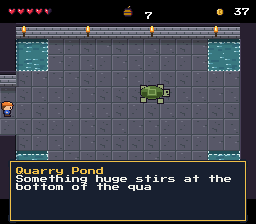
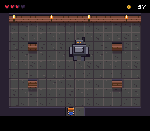
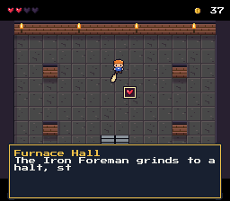
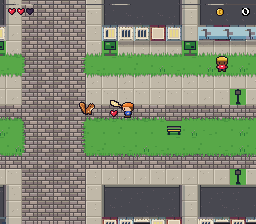
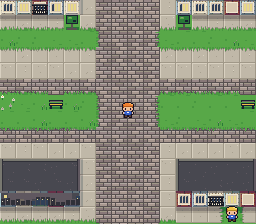

# River City Quest for the Super Nintendo

[](https://github.com/doodersrage/river-city-quest-snes/actions/workflows/build.yml)

A port of [River City Quest](https://github.com/doodersrage/river-city-quest), the Zelda-style adventure set in Richmond, Virginia, to a real SNES ROM.

**Download:** the newest build is always on the [latest release](https://github.com/doodersrage/river-city-quest-snes/releases/tag/latest) as `RiverCityQuest.sfc`.
Open it in any SNES emulator (Snes9x, bsnes, Mesen, RetroArch; Snes9x EX+ on Android), or copy it to a flash cart to play on real hardware.

| | |
|---|---|
|  |  |
| The Gold-Bug fetching the key from the island | The Raven beaten: the Brick Keystone |
|  |  |
| Every brazier lit in the Hall of Lamps | The Wraith, solid after its own orb hits it |
|  |  |
| Old Snapper wakes in the Quarry Pond | Beaten: the Granite Keystone and a heart container |
|  |  |
| The Iron Foreman in Tredegar's Furnace Hall | Beaten: stairs and a heart container |
|  |  |
| Buying a heart charm at Carytown Goods | Your row house in the Fan |
|  |  |
| The paddle against a squirrel in the Fan | Hold A, let go: spin attack |
|  |  |
| Reading the Arthur Ashe marker in the Fan | Talking to the Runner |
|  |  |
| The Fan, where you start | Walk south into Hollywood Cemetery |

## What works so far

- **Stage 1:** walk all 24 outdoor neighbourhoods, from Richmond Raceway to Ancarrow's Landing, using the web game's art. Walk off any edge into the next neighbourhood. Start is in the Fan.
- **Stage 2:** press A to read historical markers, landmarks, signs, murals and gas lamps, and to talk to the 70 people standing around town, in the web game's own pixel font. People turn to face you and cycle through their lines.

- **Stage 6 (in progress):** the **Poe Museum cellar** under Shockoe Bottom: light the Wine Cellar's braziers for a key, clear the Raven's Study for **the Gold-Bug** (throw it with B: it stuns small foes and fetches what it touches), send it over the Enchanted Garden's pond for the island key, and beat **the Raven** (it hovers, throws feathers and dives) for the **Brick Keystone**. Before that, the Archivist in Capitol Square gives you the **Gas Lantern**. The Hollywood Cemetery **Pyramid** (blast the rubble off its door): light four braziers to open the Hall of Lamps, the **Cast-Iron Shield** (turns shots you face), a key, and **the Wraith**, which you can only hurt after sending its own orb back with the shield or the paddle. It guards the **Iron Keystone**. Earlier in this stage, the Belle Isle Quarry: crabs and bats, a key, the Powder Store and **Blasting Powder** on B (kegs blow open cracked walls and the rubble on the pyramid door, cut bushes and hurt enemies, including you), and **Old Snapper**, who charges in a line and stuns himself on the walls. He guards the **Granite Keystone**, the first of four. SELECT switches between your items. The game now holds a full 60 frames a second everywhere.
- **Stage 5:** Tredegar Iron Works, behind Hollywood Cemetery, start to finish: four rooms, rooms that stay cleared, a chest that appears when you clear the Pattern Shop, the Grappling Hook on B (pull yourself across pits to iron posts, stun enemies), a small key and locked door, a gate that opens when the Casting Floor is cleared, and the Iron Foreman: hook his chest plate off, then paddle him. If the fog takes you in there, you wake at the entrance.
- **Stage 4:** walk through doors into 24 interiors and caves (museums, the Byrd, the Hippodrome, St. John's, the Tea Room, your row house and more), and back out the stairs. Cut bushes. Open the hidden chest in every neighbourhood. Shop at Carytown Goods and the 17th Street Market with your coins. The other dungeons' doors turn you back for now.
- **Stage 3:** A swings the kayak paddle; hold A after a swing and let go for a spin attack. Hearts and coins in the corner. Rats, squirrels, geese, scooters, crabs, bats and ghosts behave as in the web game and drop coins and hearts. When the fog takes you, you wake by the fountain in Capitol Square.

Every build is played in the snes9x core in CI: it reads a marker, talks to someone, beats an enemy, spins, cuts a bush to open a chest, visits the row house, buys a heart charm in Carytown, walks into the next neighbourhood, plays through Tredegar Iron Works, the Belle Isle Quarry, the Pyramid and the Poe cellar and beats all four bosses, and lets a ghost finish it off (`tools/boottest.py`, driven by `tools/sneslab.py`).
Branch builds are published as `dev-<branch>` pre-releases for testing.

See [ROADMAP.md](ROADMAP.md) for the stages still to come.

## Building

Needs a built [PVSnesLib](https://github.com/alekmaul/pvsneslib) (CI pins the exact commit in `.github/workflows/build.yml`).

```sh
export PVSNESLIB_HOME=/path/to/pvsneslib
make
```

### Regenerating the art from the web game

The converted data in `data/` is committed, so building does not need this. To refresh it after the web game changes:

```sh
git clone https://github.com/doodersrage/river-city-quest ../river-city-quest
tools/regen.sh ../river-city-quest
```
